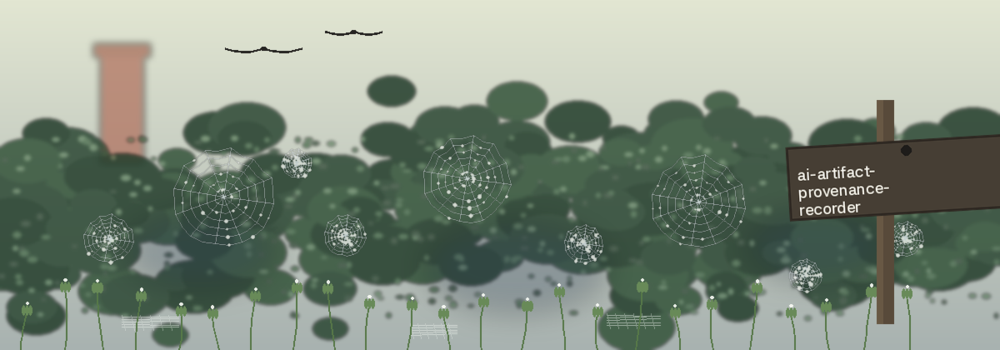

# ai-Artifact-Provenance-Recorder

Records the build steps (commands, versions) that created an artifact, computes the artifact hash, and writes both into a JSON provenance file that can be used to check the artifact's lineage later. It records hashes only: it does not verify digital signatures, and it does not compare the artifact against an expected hash.

## Install

`git clone https://github.com/ShadowGuard-AI/ai-artifact-provenance-recorder`

## Usage

```
python3 main.py <artifact_path> [--provenance_file FILE] [--command COMMAND] [--version VERSION] [--hash_algorithm ALGORITHM]
```

Verified example:

```
python3 main.py report.pdf --provenance_file provenance.json --command "make build" --version "1.0"
```

This writes `provenance.json` with the artifact path, a UTC creation stamp, the build step, and the sha256 hash of the file.

## Parameters

- `artifact_path`: path to the artifact (required). A missing artifact logs an error and exits 1.
- `--provenance_file`: name of the provenance file (default: `provenance.json`)
- `--command`: command executed to build the artifact
- `--version`: version of the tool used to build the artifact
- `--hash_algorithm`: hashing algorithm name accepted by Python `hashlib` (default: `sha256`)
- `-h` / `--help`: show help and exit

## Requirements

Python 3 with only the standard library. This repository has no third party dependencies.

## License

Copyright (c) ShadowGuard-AI
